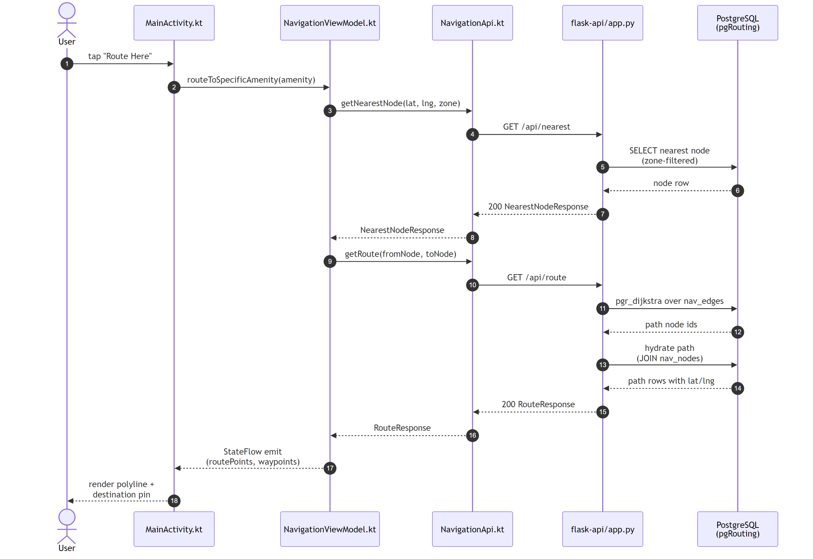

# Accessible Indoor Navigation System (class project)

An Android app that finds the nearest open restroom or amenity and walks you there, without ever crossing to the other side of security. We used the DFW Terminal D floor plan as the map. It was my UT Dallas capstone in spring 2026, not work for the airport. My team of four won the course's Best Implementation award.

**My part:** I started the repo and led the team through three iterations. The app covers zone rules (every map node is tagged as before or after security, and routes only use nodes on your side), turn-by-turn directions, rerouting when a restroom closes or fills up, and an admin portal for opening and closing amenities.

**Stack:** Kotlin and the Google Maps SDK on Android, a Python Flask API, PostgreSQL on AWS RDS.

## How a route request flows

## Repo layout

- `android-app/`: the Kotlin Android client
- `flask-api/`: the Flask REST API
- `docs/`: diagrams and test plans
- `other mock apis/`: early mock APIs from the first iteration
